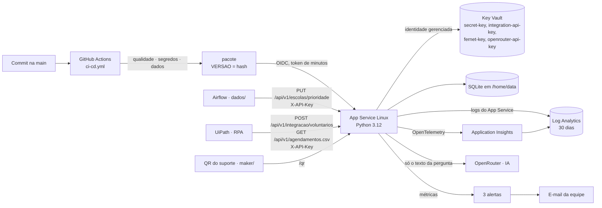

# Secure DevOps Tools & Cloud Computing: o MVP integrado em produção

Esta é a parte de Produção do produto: o **mesmo núcleo** que integra Dados, IA Generativa, Visão e Maker Lab (pasta [`mvp/`](../mvp/)) é publicado na Azure por um pipeline com verificações de segurança, segredos no Key Vault, acesso por papel e alertas.

## Arquitetura



| Decisão | Por quê |
|---|---|
| App Service Linux (PaaS) | HTTPS, TLS e identidade gerenciada sem administrar servidor |
| Região `westus3` (provisória) | A assinatura de avaliação não tinha cota de App Service em `brazilsouth`. O Aviso de Privacidade (`/privacidade`) mostra a região real (variável `REGION_NAME` do App Service). Para um piloto com estudantes reais: `LOCAL=brazilsouth` |
| HTML renderizado no servidor | Páginas leves, sem scripts de terceiros, boas para celular de entrada |
| SQLite em `/home/data` | Custo zero e nenhuma credencial de banco; o SQLAlchemy permite trocar por PostgreSQL mudando `DATABASE_URL` |
| Key Vault + identidade gerenciada | Nenhum segredo no código, no repositório ou no pipeline |
| Deploy com OIDC | O GitHub não guarda senha da Azure; o token vale minutos e só para o environment `production` |
| Application Insights (OpenTelemetry) | Requisições, falhas e logs num só lugar |

## Pipeline ([`.github/workflows/ci-cd.yml`](../.github/workflows/ci-cd.yml))

| Job | Quando | O que faz |
|---|---|---|
| `qualidade` | PR e push | `ruff` (lint com as regras de segurança `S` do flake8-bandit, config em [`mvp/ruff.toml`](../mvp/ruff.toml)), `pytest` com cobertura mínima de 80%, `bandit` e `pip-audit` |
| `pipeline-dados` | PR e push | Testes do ETL de [`dados/`](../dados/) |
| `segredos` | PR e push | `gitleaks` em **todo o histórico** do repositório |
| `pacote` | push na `main` | Grava o hash do commit em `mvp/VERSAO` e gera `mvp.zip` só com `app/`, `requirements.txt`, `startup.sh` e `VERSAO` |
| `deploy` | depois do `pacote` | Login OIDC, publicação no App Service e **smoke test**: espera `/health` responder `status: ok` com a **versão do commit** |

O deploy só roda se os três primeiros jobs passarem, e só termina verde quando a versão nova está no ar. Enquanto a variável `AZURE_WEBAPP_NAME` não existir, ele é pulado (o CI continua funcionando).

Complementos: [CodeQL](../.github/workflows/codeql.yml) a cada push e toda segunda-feira (o code scanning do GitHub exige repositório **público** em conta pessoal; no privado o job é pulado) e [Dependabot](../.github/dependabot.yml) para `mvp/`, `dados/` e as actions.

Rodar as mesmas verificações localmente:
```bash
cd mvp
.venv/Scripts/python -m pip install -r requirements-dev.txt
.venv/Scripts/python -m ruff check app tests
.venv/Scripts/python -m pytest -q --cov=app --cov-fail-under=80
.venv/Scripts/python -m bandit -r app -ll
.venv/Scripts/python -m pip_audit -r requirements.txt
```

## Ambiente em produção

O MVP integrado roda em **https://app-apoioescolar-mvp-6e7462.azurewebsites.net**, num Web App próprio (`app-apoioescolar-mvp-6e7462`) no mesmo plano B1 (`plan-apoioescolar`) e no mesmo Resource Group (`rg-apoio-escolar-gs`, West US 3) do app da disciplina (`app-apoioescolar-6e7462`), que segue no ar. Não há custo extra de App Service.

| Item | Como está configurado |
|---|---|
| Web App | Python 3.12, `sh startup.sh`, só HTTPS, TLS 1.2, FTP e autenticação básica (FTP e SCM) desligados, HTTP/2, Always On, health check em `/health`, tags do projeto |
| Segredos | Próprios do MVP no Key Vault `kv-apoioescolar-6e7462`: `MVP-SECRET-KEY`, `MVP-INTEGRATION-API-KEY` e `MVP-FERNET-KEY`, gerados no Cloud Shell sem aparecer na tela. O app lê por referência `@Microsoft.KeyVault(...)` com a identidade gerenciada (Key Vault Secrets User) |
| Banco | SQLite em `/home/data/apoio-mvp.db` |
| Monitoramento | Application Insights `appi-apoioescolar` e Log Analytics `log-apoioescolar` compartilhados; alertas `alerta-mvp-health-check` (sev 0), `alerta-mvp-erros-5xx` (sev 1) e `alerta-mvp-lentidao` (sev 2) no grupo de ação `ag-apoioescolar` |
| Deploy (OIDC) | Identidade gerenciada `id-github-deploy-mvp` com credenciais federadas para `repo:GiantMazelliWasHere/apoio-escolar-periferico:environment:production` e `:ref:refs/heads/main`, e papel **Website Contributor só neste Web App**. Usamos identidade gerenciada em vez de app registration: não exige permissão no Entra ID e não tem segredo |
| GitHub | Variáveis do repositório `AZURE_CLIENT_ID`, `AZURE_TENANT_ID`, `AZURE_SUBSCRIPTION_ID`, `AZURE_WEBAPP_NAME` e environment `production` |

Acesso da equipe: Contributor e Role Based Access Control Administrator (restrito a Website Contributor, Key Vault Secrets User e Reader) no RG, e Key Vault Secrets Officer no Key Vault.

## Infraestrutura do zero ([`infra/provisionar.sh`](../infra/provisionar.sh))

Script Azure CLI **idempotente** (pode rodar de novo). Rodar no **Azure Cloud Shell (Bash)**, que já vem logado, ou no Git Bash/WSL depois de `az login`:

```bash
git clone https://github.com/GiantMazelliWasHere/apoio-escolar-periferico.git
cd apoio-escolar-periferico
EMAIL_ALERTA=<email-da-equipe> LEITORES=<email-prof>,<email-integrante> ./infra/provisionar.sh
```

Opcional: `OPENROUTER_API_KEY=<chave>` grava a chave da IA no Key Vault (sem ela, a tela Ajuda mostra só as perguntas frequentes); `LOCAL=brazilsouth`; `SKU=F1` (custo zero); `APP=<nome>` para reaproveitar um Web App existente no mesmo RG.

O que ele cria, tudo no Resource Group `rg-apoioescolar` com tags (`projeto`, `disciplina`, `ambiente`, `equipe`):

- **App Service Plan** Linux B1 e **Web App** Python 3.12: só HTTPS, TLS mínimo 1.2, FTP e autenticação básica (FTP e SCM) desligados, HTTP/2, Always On, health check em `/health`, comando de inicialização `sh startup.sh`.
- **Key Vault** com RBAC: `secret-key`, `integration-api-key` e `fernet-key` (cifra do e-mail do responsável) gerados pelo script direto no cofre (nunca aparecem na tela); `openrouter-api-key` se informado. O Web App lê cada um por referência `@Microsoft.KeyVault(...)` com a identidade gerenciada.
- **Log Analytics** (30 dias, teto diário de ingestão de 0,5 GB) + **Application Insights** baseado no workspace; logs HTTP, de console e de plataforma do App Service vão para o mesmo workspace.
- **Grupo de ação** (e-mail) e três **alertas**:

  | Alerta | Condição (janela de 5 min) | Severidade |
  |---|---|---|
  | `alerta-health-check` | `HealthCheckStatus` médio < 100 | 0 (crítico) |
  | `alerta-erros-5xx` | Mais de 5 respostas 5xx | 1 (erro) |
  | `alerta-lentidao` | Tempo médio de resposta > 3 s | 2 (aviso) |

- **Orçamento** mensal no RG (padrão 150 na moeda da conta) com aviso por e-mail em 80%.
- **Identidade gerenciada do GitHub** (`id-github-deploy`, user-assigned, sem segredo e sem precisar de permissão no Entra ID) com credenciais federadas para os dois formatos de *subject* que o GitHub pode enviar: `repo:<dono>/<repo>:environment:production` e, com IDs fixos, `repo:<dono>@<id>/<repo>@<id>:environment:production` (os IDs vêm do `gh`). Papel **Website Contributor só no Web App**.
- No fim, grava as variáveis `AZURE_CLIENT_ID`, `AZURE_TENANT_ID`, `AZURE_SUBSCRIPTION_ID` e `AZURE_WEBAPP_NAME` no repositório com o `gh` (se estiver logado) ou imprime os comandos. Nenhuma delas é segredo.

Depois: push na `main` (ou **Actions > CI/CD > Run workflow**) publica o MVP. Para apagar tudo após a correção: `CONFIRMAR=sim ./infra/remover.sh`.

## Acesso por papel

| Identidade | Papel | Escopo |
|---|---|---|
| Identidade gerenciada do Web App | Key Vault Secrets User (só leitura) | Só o Key Vault |
| GitHub Actions (OIDC) | Website Contributor | Só o Web App |
| Quem roda o provisionamento | Key Vault Secrets Officer | Só o Key Vault |
| Professor e integrantes (`LEITORES`) | Reader | Resource Group (contas de fora do diretório precisam ser convidadas antes no Entra ID) |

Na aplicação: **estudante**, **voluntário** (só publica horários depois de aprovado) e **coordenação** (aprova voluntários), com `exigir_papel` em [`mvp/app/security.py`](../mvp/app/security.py). O voluntário vê do estudante só apelido, ano escolar e dúvida; indicadores escondem grupos com menos de 5 pessoas. Integrações máquina-a-máquina (Airflow, RPA) usam `X-API-Key` com o valor do Key Vault.

## Segurança na aplicação

Proteção de dados de menores (consentimento do responsável por link, e-mail cifrado, baixar e apagar a conta, expurgo em 30 dias, auditoria) e riscos aceitos: [seguranca-lgpd.md](seguranca-lgpd.md).

- **Segredos obrigatórios:** em produção (`APP_ENV=production`) o app **não sobe** sem `SECRET_KEY`, `INTEGRATION_API_KEY` e `FERNET_KEY` ([`mvp/app/config.py`](../mvp/app/config.py)).
- **Cabeçalhos** ([`mvp/app/protecao.py`](../mvp/app/protecao.py)): CSP sem scripts inline nem de terceiros, `frame-ancestors 'none'`, HSTS (produção), `nosniff`, `Referrer-Policy`, `Permissions-Policy`. O Swagger (`/api/docs`) fica fora da CSP porque carrega scripts de CDN.
- **Sessão:** cookie `Secure` (produção), `HttpOnly` e `SameSite=Lax`; CSRF em todos os formulários e chamadas JSON.
- **Limites:** login 10 tentativas por IP a cada 5 min; cadastros 10 por IP por hora; link do responsável 20 por IP por hora; assistente e leitura de foto com limites próprios (`429`).
- **Senhas:** PBKDF2-SHA256 com 200 mil iterações e sal.
- **Telemetria sem dados pessoais:** só rota, status, duração e erros; `/health` fica fora da telemetria. Detalhes no Aviso de Privacidade (`/privacidade`).
- **Health check** (`/health`): testa o banco e devolve `{"status": "ok", "banco": "ok", "versao": "<hash>"}`; `503` se o banco cair.

## Custo estimado (US$/mês)

| Recurso | Configuração | Custo |
|---|---|---|
| App Service Plan | Linux B1, 1 instância | ~12,41 (West US 3) |
| Key Vault | Standard, poucas centenas de leituras | < 0,10 |
| Log Analytics + Application Insights | < 1 GB/mês | 0 (franquia) |
| Alertas de métrica | 3 regras | ~0,30 |
| Tráfego, e-mails, GitHub Actions | | 0 (franquias) |
| **Total** | | **~13** |

Com `SKU=F1` o custo vai a zero (sem Always On, o primeiro acesso depois de um tempo parado é lento e pode disparar o `alerta-lentidao`). O OCR da Visão fica desligado no B1 (o EasyOCR precisa de ~1 GB de RAM; ver [INTEGRACAO.md](INTEGRACAO.md)).

## Checklist de evidências para a entrega

1. `/health` na URL pública mostrando `versao` igual ao hash do último commit.
2. Execução do workflow com `qualidade`, `segredos`, `pipeline-dados`, `pacote` e `deploy` verdes, e o log do smoke test.
3. Portal: Resource Group com tags; Web App > Configuração (HTTPS Only, TLS 1.2, FTP desligado); Configurações de aplicativo como referências ao Key Vault (ícone verde); Key Vault > Segredos (só os nomes); IAM do Key Vault, do Web App e do RG; Identidade gerenciada do GitHub > Credenciais federadas.
4. Application Insights com tráfego; Alertas > Regras; e-mail de um alerta disparado e resolvido (parar e religar o Web App provoca o `alerta-health-check`/`alerta-lentidao`).
5. Cost Management > Orçamentos.
