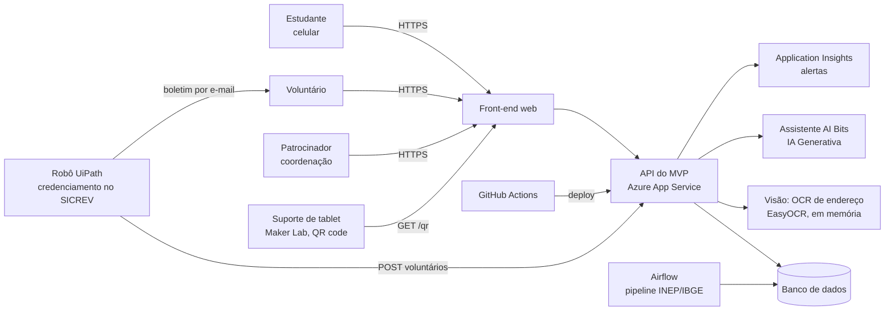

# Ficha Técnica do MVP — Apoio Escolar Periférico
**Global Solution FIAP 2026.2 · CitizenTech · Engenharia de Software 4º ano · Turma 4ESPR**

> **Para que serve (slide 20 do PDF oficial):** "a base comum da equipe". A ficha responde às seis perguntas do briefing e mostra onde cada componente se encaixa. Ela deve **abrir o README do repositório principal** e a documentação de cada disciplina, para que todos os professores avaliem o mesmo produto com a mesma lógica. A disciplina de DevOps também exige a ficha abrindo o README (slide 40).
>
> **Legenda:** ✅ definido · 🟡 planejado, ainda não confirmado no repositório · ⬜ [PREENCHER] quando a entrega da disciplina chegar.
> Não marquem um componente como ✅ antes de ele estar no repositório e funcionando.

---

## Equipe

| Integrante | RM | Disciplina / componente sob responsabilidade |
|---|---|---|
| Edson Leonardo | 553737 | Applied Computer Vision (Visão) · Generative AI for Engineering (Inteligência) |
| Eduardo Mazelli | 553236 | Business Intelligence & Startup Development (Negócio e pitch) |
| Jó Sales | 552679 | Big Data Architecture & Data Integration (Dados) |
| Miguel Garcez de Carvalho | 553768 | Robotic Process Automation (Automação) · Secure DevOps Tools & Cloud Computing (Produção) |
| Vinicius Souza e Silva | 552781 | Project-Based Maker Lab (Físico) |

---

## A ficha (campos do slide 20)

| Campo | Conteúdo | Status |
|---|---|---|
| **Nome do produto** | Apoio Escolar Periférico | ✅ |
| **Cidadão e território** | Estudantes de escolas públicas (Ensino Fundamental II e Ensino Médio, ≈ 11 a 18 anos) que moram em comunidades periféricas com acesso limitado a reforço escolar. Território piloto: escolas com IDEB abaixo da média do município, escolhidas pelo pipeline de Dados. Município/bairro: [PREENCHER] | ✅ cidadão · ⬜ território |
| **Problema, em uma frase** | Estudantes da periferia não têm acesso a reforço escolar gratuito, com acompanhamento de uma pessoa e no horário deles, e isso alimenta atraso, reprovação e menos oportunidades futuras. | ✅ |
| **Proposta de valor** | Reforço escolar gratuito, com monitor de verdade, para quem estuda na periferia, e impacto social comprovado para quem financia. O estudante nunca paga: empresas com agenda ESG patrocinam núcleos escolares e recebem painel e relatórios de impacto. | ✅ |
| **Arquitetura: componentes** | Ver a tabela "Componentes por disciplina" abaixo e o diagrama. | 🟡 |
| **Fontes de dados** | Públicas: INEP (IDEB, Censo Escolar, SAEB) e IBGE (dados socioeconômicos por território). Operacionais: cadastros, agendamentos e presenças gerados pelo próprio MVP. Simulados: estudantes, voluntários e monitorias **sintéticos**, com geração documentada (sem dados pessoais reais). Visão: documentos sintéticos de contas de consumo com gabarito. Dados: o pipeline simula a extração INEP/IBGE para as 6 escolas fictícias do seed (código INEP com prefixo 99). | 🟡 |
| **Modelos de IA utilizados** | Visão Computacional: detecção do documento, correção de perspectiva, pré-processamento e OCR para extrair o endereço. IA Generativa: assistente da plataforma, com LLM via API (OpenRouter, modelo configurável), prompt com o contexto da documentação do MVP e saída estruturada em JSON. Modelo padrão: `google/gemini-2.5-flash` (configurável por `GENAI_MODEL_NAME`). | ✅ Visão (integrada ao cadastro, testada com EasyOCR real no dataset sintético) · ✅ GenAI (integrado e testado com a chave real) |
| **URL do MVP e repositório** | MVP: https://app-apoioescolar-mvp-6e7462.azurewebsites.net (Azure App Service, só HTTPS). Repositório principal: https://github.com/GiantMazelliWasHere/apoio-escolar-periferico. | ⬜ |
| **Indicadores de impacto** | Monitorias realizadas · horas de reforço entregues · taxa de presença · evolução no diagnóstico pré/pós · % de estudantes em territórios vulneráveis · estudantes ativos mensais · custo por estudante ativo. *Metas sugeridas, não resultados alcançados.* | ✅ definidos |
| **ODS conectados** | **ODS 4: Educação de Qualidade** (meta 4.1: ensino fundamental e médio de qualidade; meta 4.4: competências digitais para o trabalho). **ODS 10: Redução das Desigualdades** (meta 10.2: inclusão social e econômica de todos), porque o reforço chega aos territórios mais vulneráveis. | ✅ |

---

## As seis perguntas do briefing (slide 11)

| Pergunta | Resposta curta |
|---|---|
| 1. Quem é o cidadão beneficiado? | Estudante de escola pública em comunidade periférica |
| 2. Qual problema será resolvido? | Falta de acesso a reforço escolar gratuito, com acompanhamento e no horário do estudante |
| 3. Como a solução funcionará? | Plataforma web: cadastro → busca de monitoria por matéria → agendamento com voluntário → assistente de IA para dúvidas de uso → presença registrada → painel de impacto ao patrocinador |
| 4. Quais tecnologias serão empregadas? | Pipeline de dados (Airflow), Visão Computacional (OCR), IA Generativa, RPA (UiPath), Azure (App Service, GitHub Actions, Application Insights), suporte de tablet fabricado no Maker Lab, com QR code para a plataforma |
| 5. Quem participará do ecossistema? | Estudantes, voluntários (universitários, profissionais, voluntariado corporativo), escolas, ONGs, empresas patrocinadoras, fundos e editais |
| 6. Como o impacto poderá ser medido e ampliado? | Indicadores acima, reportados em painel e relatório; expansão por núcleo escolar, replicando o modelo em novos territórios |

---

## Componentes por disciplina

| Componente | Disciplina (professor) | O que entra no MVP | Como conversa com o resto | Status |
|---|---|---|---|---|
| **Núcleo do MVP** (front + API + banco) | Sem disciplina própria: é o produto que todas usam | Cadastro, busca e agendamento de monitorias, painéis do estudante e do voluntário, painel de impacto público. Pasta [`mvp/`](../mvp/): FastAPI + Jinja + SQLAlchemy (SQLite/PostgreSQL), 63 testes automatizados | API REST (`/api/docs`) + banco de dados; contratos em [INTEGRACAO.md](INTEGRACAO.md) | ✅ local · ⬜ no ar |
| **Dados** | Big Data Architecture & Data Integration (Ana Machado) | DAG no Airflow (extract → transform → load) que ingere IDEB/Censo Escolar/IBGE (simulados), calcula o Índice de Prioridade Educacional das escolas periféricas e gera a camada Trusted | A última tarefa chama `PUT /api/v1/escolas/prioridade` no núcleo (`X-API-Key`); o painel de impacto mostra o índice e a origem. Entrega da disciplina em [`dados/`](../dados/) | ✅ integrado, com testes automatizados e executado no Airflow 2.10.5 (Docker) contra o núcleo local; diagrama e prints no PDF da disciplina · ⬜ rodar contra a URL da Azure |
| **Inteligência** | Generative AI for Engineering (Reinaldo Ramos) | Assistente que tira dúvidas sobre a plataforma (cadastro, agendamento, privacidade, erros comuns), via OpenRouter, com resposta em JSON e tratamento de falhas; dúvida de matéria é encaminhada ao monitor humano | Tela "Ajuda" do front chama `POST /api/v1/assistente`; entrega da disciplina em [`ia/`](../ia/), código integrado em [`mvp/app/assistente.py`](../mvp/app/assistente.py) | ✅ integrado, com testes automatizados (modelo simulado) e testado com a chave real do OpenRouter |
| **Visão** | Applied Computer Vision (Wilians Souza) | Extração do endereço de fotos de contas (3 empresas, ex.: Enel, Sabesp, Claro), com confirmação do usuário | Tela de cadastro envia a foto para `POST /api/v1/visao/endereco`; o estudante confere bairro e CEP e só eles vão para o banco. Entrega da disciplina em [`visao/`](../visao/) ([EdLeo0708/Applied-Computer-Vision](https://github.com/EdLeo0708/Applied-Computer-Vision)), código integrado em [`mvp/app/visao.py`](../mvp/app/visao.py) | ✅ integrado, com testes automatizados (OCR simulado) e testado com EasyOCR real · ⬜ OCR no Azure (exige plano com mais RAM) |
| **Automação** | Robotic Process Automation (Cibele Ribeiro) | Robô UiPath híbrido: triagem das inscrições de voluntários (9 regras, LGPD e duplicidade), credenciamento no portal legado da Diretoria de Ensino (SICREV, sem API) e boletim em lote só para quem consentiu | Devolve os credenciados ao núcleo por `POST /api/v1/integracao/voluntarios` (`X-API-Key`); entram como pendentes de aprovação da coordenação. Relatório em [`rpa/`](../rpa/) | ✅ contrato implementado e testado no núcleo · ⬜ projeto UiPath no repositório |
| **Produção** | Secure DevOps Tools & Cloud Computing (Gabriel Arcanjo) | MVP na Azure com HTTPS, deploy automático a cada commit, segredos fora do código, acesso por papel e alertas | Workflow [ci-cd.yml](../.github/workflows/ci-cd.yml) (ruff, pytest ≥ 80%, bandit, pip-audit, gitleaks, deploy OIDC com smoke test em `/health`) → Azure App Service; segredos no Key Vault; Application Insights e 3 alertas; infraestrutura em [infra/provisionar.sh](../infra/provisionar.sh). Detalhes em [DEVOPS.md](DEVOPS.md) | 🟡 pronto no repositório · ⬜ provisionar e publicar |
| **Físico** | Project-Based Maker Lab (Caio Sousa) | Suporte de tablet para estudo (desenho 3DP-2026-004 rev. C: peça única de chapa dobrada de 2 mm, 110 × 125 × 104 mm, painel a 65°, impressa em 3D sem suporte), com etiqueta de QR code para a plataforma. Arquivos em [maker/](../maker/README.md) | QR code → `GET /qr` marca a origem → o cadastro grava `origem = peca_maker` → `/impacto` mostra "Cadastros vindos da peça Maker Lab" | ✅ desenho técnico, STEP/3MF/STL e integração no repositório · ✅ protótipo impresso em PETG e [publicado no MakerWorld](https://makerworld.com/en/models/3634500-tablet-stand-for-studying-with-qr-code) |
| **Negócio e pitch** | BI & Startup Development (Henio Scheidt) | Lean Canvas, modelo de negócio, indicadores, vídeo-pitch com demo | Indicadores lidos do banco do MVP | ✅ documento em [docs/business](business/Entrega_Business_Apoio_Escolar_Periferico.md) |

### Diagrama (proposta — atualizar quando os componentes chegarem)

---

## Princípios de engenharia (slide 21)

| Princípio | Como o MVP atende | Status |
|---|---|---|
| Segurança e LGPD by design | Credenciais em variáveis de ambiente/Key Vault; dados mínimos do estudante; consentimento do responsável para menores (LGPD art. 14); aviso claro do que é coletado e por quê | 🟡 |
| Acessível de verdade | Contraste acima do WCAG AA em todas as combinações (tabela abaixo), modo escuro automático, link "Pular para o conteúdo", rótulos e regiões ARIA, foco visível para navegação por teclado, alvos de toque de 44 a 52 px no celular, linguagem simples | ✅ |
| Resiliente ao mundo real | Páginas leves para celular de entrada e conexão fraca; lembretes por SMS/WhatsApp | 🟡 |
| IA responsável | A assistente tem escopo limitado ao uso da plataforma, não guarda a conversa e encaminha dúvidas de matéria ao monitor humano; endereço extraído sempre confirmado pelo usuário | 🟡 |
| Integração real | Componentes conversam por API e banco, não por prints colados lado a lado | 🟡 |
| Reprodutível | README, requirements e instruções para rodar e testar | ✅ núcleo (README + 63 testes) |

### Contraste da paleta do MVP (WCAG 2.1, mínimo AA = 4,5:1 para texto normal)

| Combinação | Cores | Contraste |
|---|---|---|
| Texto principal / fundo claro | `#1c1b19` sobre `#fbfaf7` | 16,5:1 |
| Texto secundário / fundo claro | `#5a5750` sobre `#fbfaf7` | 6,9:1 |
| Botão (texto / verde da marca) | `#ffffff` sobre `#0b6e4f` | 6,3:1 |
| Texto principal / fundo escuro | `#f1efe9` sobre `#141412` | 16,0:1 |
| Texto secundário / fundo escuro | `#b6b2a8` sobre `#141412` | 8,7:1 |
| Botão no modo escuro | `#0b1f17` sobre `#4fc79a` | 8,2:1 |

Fundo off-white e texto quase preto (sem preto ou branco puros) reduzem o brilho excessivo; o modo escuro usa fundo grafite em vez de preto absoluto. Cores semânticas: verde para ação e sucesso, vermelho para erro.

---

## Links da entrega
| Item | Link |
|---|---|
| MVP (URL pública) | https://app-apoioescolar-mvp-6e7462.azurewebsites.net |
| Repositório principal | https://github.com/GiantMazelliWasHere/apoio-escolar-periferico |
| Repositório de Visão Computacional | https://github.com/EdLeo0708/Applied-Computer-Vision |
| Vídeo-pitch (YouTube, não listado) | https://youtu.be/bXGTEOwcj2w |
| Projeto no MakerWorld | https://makerworld.com/en/models/3634500-tablet-stand-for-studying-with-qr-code |
