# Maker Lab: suporte de tablet para estudo

**Disciplina:** Project-Based Maker Lab (prof. Caio Sousa) · **Responsável:** Vinicius Souza e Silva (RM 552781)

A peça física do Apoio Escolar Periférico: um suporte para o estudante apoiar o tablet ou o celular durante a monitoria online e ficar com as mãos livres para o caderno. Uma etiqueta com QR code leva direto para a plataforma, e o MVP conta quantos cadastros chegaram por ela.

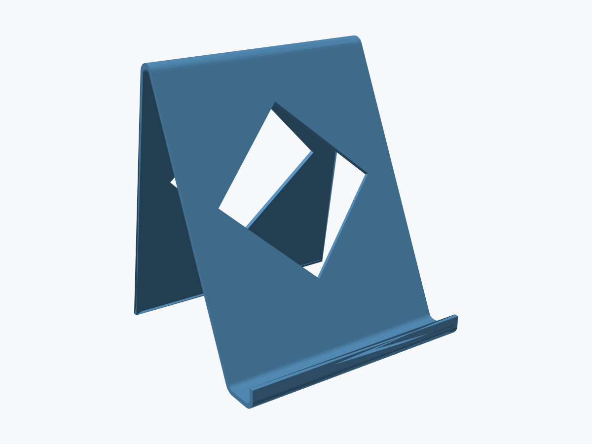

## A peça (desenho 3DP-2026-004 rev. C, 17/11/2026)

| Item | Medida |
|---|---|
| Formato | Peça única, chapa dobrada de **2 mm** em forma de A (dobras R3 int. / R5 ext.) |
| Tamanho | **110 × 125 × 104 mm** (largura × altura × fundo) |
| Painel de leitura | 65° em relação à mesa |
| Perna traseira | 80°, para não tombar |
| Encaixe na base | 15 mm de largura e 10 mm de altura (aceita capa de até ~14 mm) |
| Janelas | Losango de 80 × 80 mm nos dois painéis, para economizar material |
| Aparelhos | Feito para o Galaxy Tab A 8.0 (2017); serve de 7" a 11" e celulares, deitados ou em pé |
| Material | Protótipo em **PETG**: 90 g com o brim, 5 h numa Creality Ender 3 (a peça tem ~51 cm³, calculado do STL; PLA também serve) |
| Etiqueta QR | 30 mm, canto inferior da face de trás da perna traseira |
| Tolerância | ± 0,5 mm |

| Lateral | Frontal |
|---|---|
| 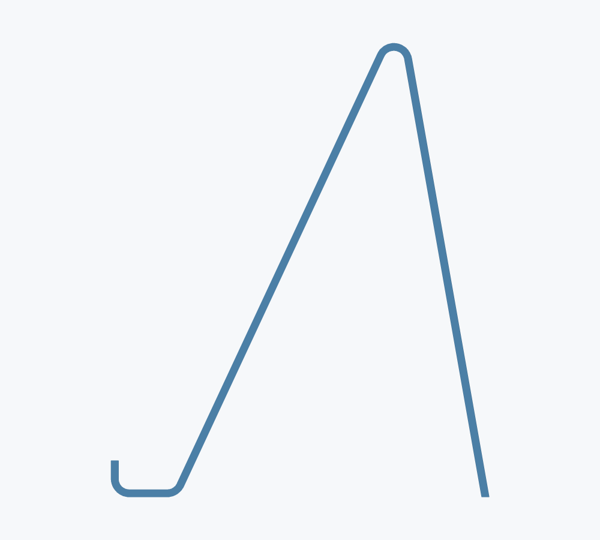 | 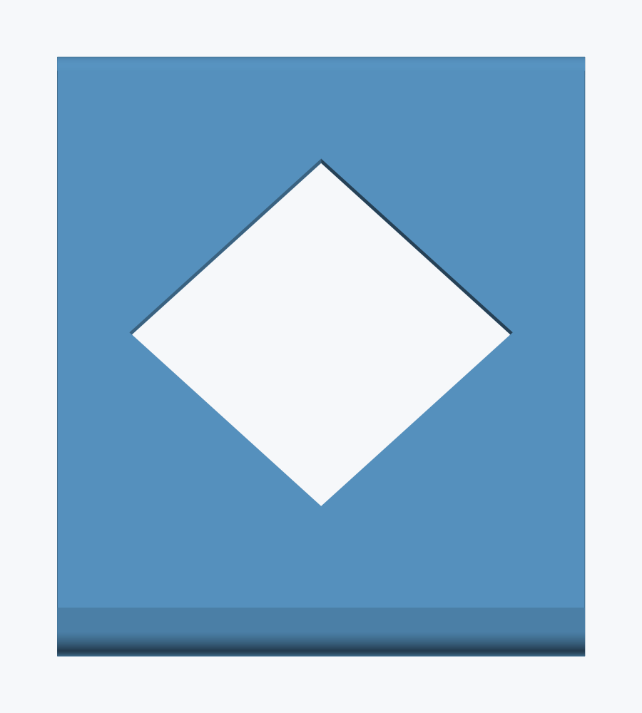 |

**Por que a etiqueta vai na perna traseira:** o painel da frente fica coberto pelo tablet durante o uso. Atrás, o QR fica visível para quem está na mesma sala enquanto o estudante usa o suporte. O maior quadrado que cabe no canto do painel sem invadir a janela tem cerca de 39 mm, então 30 mm deixa margem.

## Arquivos

| Arquivo | Para quê |
|---|---|
| [`cad/suporte_tablet_3DP-2026-004_revC_desenho_tecnico.pdf`](cad/suporte_tablet_3DP-2026-004_revC_desenho_tecnico.pdf) | Desenho técnico cotado (vistas, perspectiva e especificações) |
| [`cad/suporte_tablet_3DP-2026-004_revC_desenho_2d.dxf`](cad/suporte_tablet_3DP-2026-004_revC_desenho_2d.dxf) | As mesmas vistas em DXF (abre em AutoCAD, LibreCAD, Fusion) |
| [`cad/suporte_tablet_3DP-2026-004_revC.step`](cad/suporte_tablet_3DP-2026-004_revC.step) | Modelo 3D neutro (abre em qualquer CAD) |
| [`fabricacao/suporte_tablet_3DP-2026-004_revC_impressao.3mf`](fabricacao/suporte_tablet_3DP-2026-004_revC_impressao.3mf) | Impressão 3D: pronto para o fatiador (Creality Print, OrcaSlicer, Bambu Studio, PrusaSlicer, Cura) |
| [`fabricacao/suporte_tablet_3DP-2026-004_revC_impressao.stl`](fabricacao/suporte_tablet_3DP-2026-004_revC_impressao.stl) | A mesma peça em STL |
| [`imagens/`](imagens/) | Renders gerados do STL por [`entrega/renderizar_stl.py`](entrega/renderizar_stl.py) |
| [`imagens/modelo/`](imagens/modelo/) | Capturas do modelo 3D no CAD (perspectiva, frente, lateral, de cima e perfil 2D) |
| [`imagens/fotos/`](imagens/fotos/) | Fotos da impressão do protótipo |

**Orientação de impressão:** os arquivos já vêm com o perfil dobrado deitado na mesa e os 110 mm de largura na altura. Assim as dobras saem sem suporte e as janelas em losango ficam com bordas a 45°. Recomendado: camada de 0,2 mm, 5 perímetros (parede maciça), **brim de 5 mm** (a base é só o contorno fino da chapa) e sem suporte.

## Modelo 3D

| Perspectiva | Frontal |
|---|---|
| 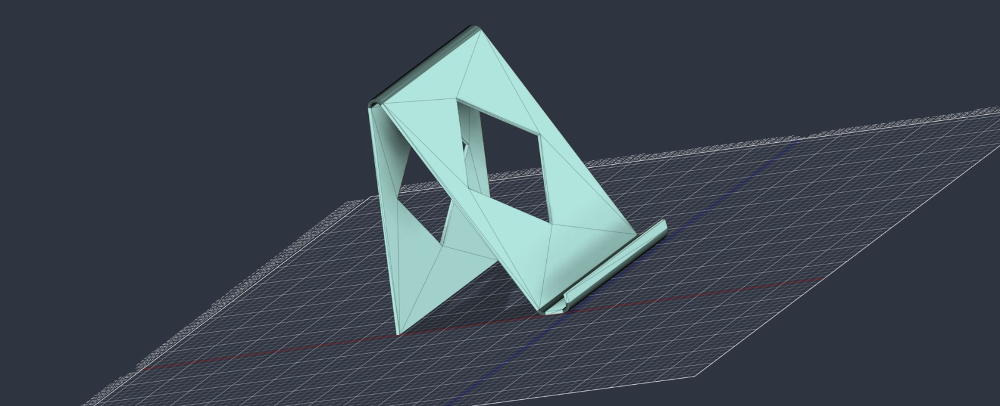 | 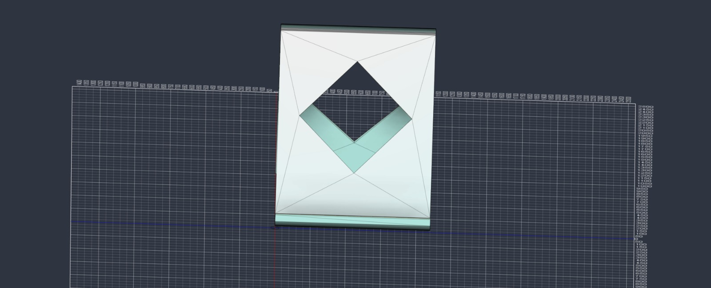 |
| 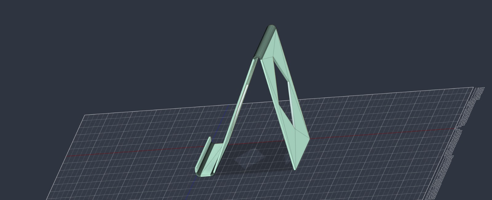 | 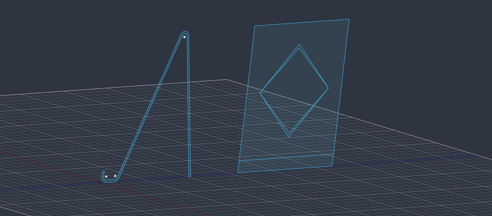 |

## Impressão do protótipo

Impresso em PETG numa Creality Ender 3 (mesa de 220 × 220 mm), em 5 horas e com 90 g de filamento, na orientação dos arquivos: perfil deitado, sem suporte, com brim.

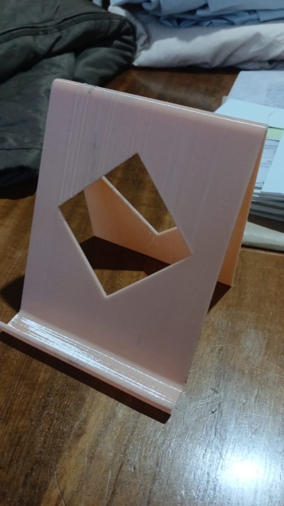

| | |
|---|---|
| 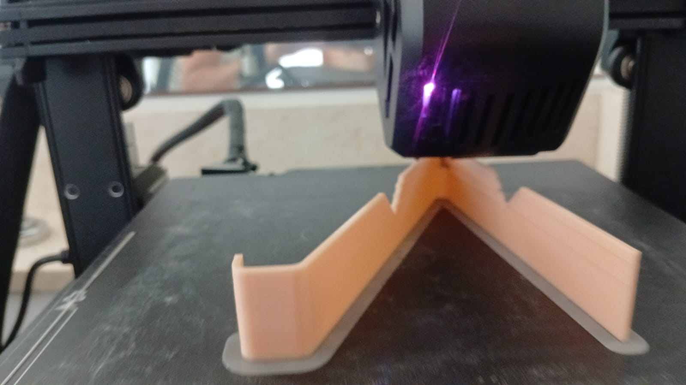 | 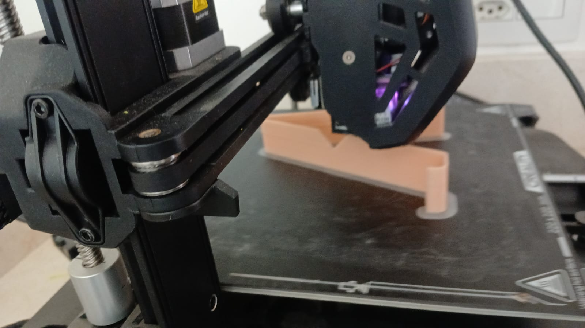 |
| 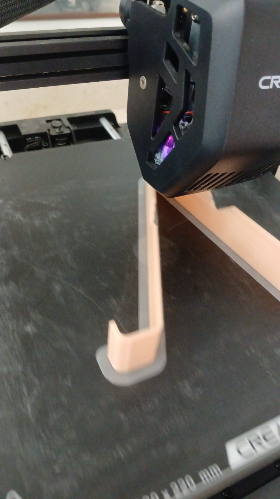 | 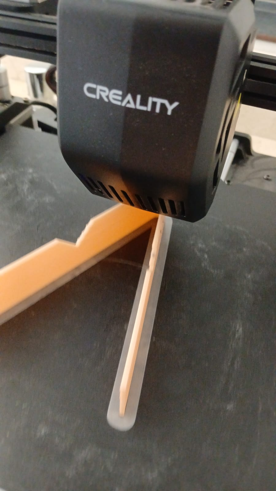 |

Mais fotos em [`imagens/fotos/`](imagens/fotos/).

A revisão anterior (duas placas de 220 × 140 mm com apoio em corte a laser) foi substituída pela rev. C e continua no histórico do git.

## Integração com a plataforma

O QR code é o contrato entre a peça e o núcleo do MVP. Não há prints colados: a peça gera um dado que o painel de impacto mostra.

```
Etiqueta QR na peça ──► GET /qr ──► sessão marcada "peca_maker" ──► página inicial (aviso "você chegou pelo QR")
                                                         │
                                  cadastro de estudante ou voluntário na mesma visita
                                                         ▼
                                    usuarios.origem = "peca_maker"
                                                         ▼
                 /impacto e /api/v1/impacto: "Cadastros vindos da peça Maker Lab"
```

| Rota do MVP | O que faz |
|---|---|
| `GET /qr` | Destino gravado no QR. Marca a origem na sessão (se a pessoa não estiver logada) e leva ao início |
| `GET /maker` | Página da peça: render, ficha, QR pronto para imprimir e o número de cadastros vindos dela |
| `GET /maker/qrcode.svg?tamanho_mm=30` | QR vetorial no tamanho físico pedido (15 a 200 mm; padrão 30), para imprimir em papel adesivo |

- **URL dentro do QR:** `PUBLIC_URL` + `/qr`. Configure `PUBLIC_URL` no App Service (ex.: `https://<app>.azurewebsites.net`). Sem ela, o QR usa o endereço pelo qual a página foi aberta, que serve para testar localmente mas **não** para a etiqueta definitiva.
- **Geração:** o próprio MVP gera o QR com o OpenCV (já instalado para a Visão Computacional), sem dependência nova. Os testes em [`mvp/tests/test_maker.py`](../mvp/tests/test_maker.py) geram o QR e o leem de volta com o detector do OpenCV.
- **Privacidade:** só o rótulo do canal (`peca_maker`) fica na conta. Nada de localização, aparelho ou horário da leitura. Está descrito na tela `/privacidade`.

## Como produzir a etiqueta

A etiqueta definitiva já está em [`fabricacao/etiqueta_qr_30mm.svg`](fabricacao/etiqueta_qr_30mm.svg), baixada do MVP publicado e apontando para `https://app-apoioescolar-mvp-6e7462.azurewebsites.net/qr`. Para gerar de novo (por exemplo, se a URL mudar):

1. Abra [`https://app-apoioescolar-mvp-6e7462.azurewebsites.net/maker`](https://app-apoioescolar-mvp-6e7462.azurewebsites.net/maker).
2. Clique em **Baixar QR (30 mm, SVG)**.
3. Imprima em 100% (sem "ajustar à página") em papel adesivo e cole no canto inferior da face de trás da perna traseira.
4. Teste com a câmera do celular: deve abrir a página inicial com o aviso "Você chegou pelo QR code do suporte de estudo".

## Entrega no portal

Passo a passo (fotos, dados da impressão, MakerWorld, pasta pública e PDF único): [`entrega/ROTEIRO_ENTREGA.md`](entrega/ROTEIRO_ENTREGA.md). O PDF é gerado por [`entrega/gerar_entrega.py`](entrega/gerar_entrega.py).

## Pendências da disciplina

- [x] Publicado no [MakerWorld](https://makerworld.com/en/models/3634500-tablet-stand-for-studying-with-qr-code) e link na [Ficha Técnica](../docs/FICHA_TECNICA_MVP.md#links-da-entrega)
- [x] Fotos da impressão (`imagens/fotos/`)
- [x] Foto da peça pronta (`imagens/fotos/07_peca_pronta.jpg`)
- [ ] (Opcional) Foto com tablet apoiado e etiqueta QR colada
- [x] Etiqueta definitiva gerada no MVP publicado (`fabricacao/etiqueta_qr_30mm.svg`)
