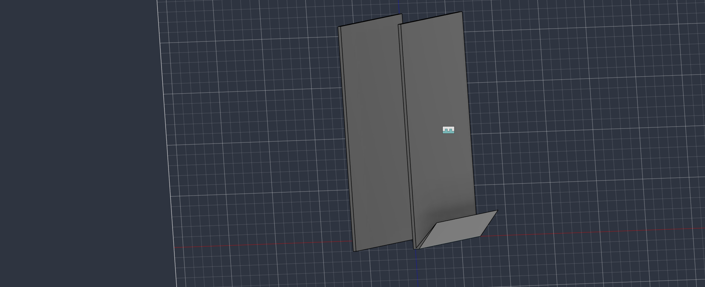

# Maker Lab: suporte de tablet para estudo

**Disciplina:** Project-Based Maker Lab (prof. Caio Sousa) · **Responsável:** Vinicius Souza e Silva (RM 552781)

A peça física do Apoio Escolar Periférico: um suporte para o estudante apoiar o tablet ou o celular durante a monitoria online e ficar com as mãos livres para o caderno. Uma etiqueta com QR code na placa da frente leva direto para a plataforma, e o MVP conta quantos cadastros chegaram por ela.



## A peça

| Item | Medida |
|---|---|
| Placas | 2 placas de **220 × 140 mm**, **3 mm** de espessura |
| Placa da frente | Com aba na base (profundidade total de 27 mm) que segura o tablet |
| Apoio traseiro | Placa lisa (`apoio traseiro:1` no modelo) que dá a inclinação |
| Pegada na mesa | Cerca de 170 mm de profundidade |
| Etiqueta QR | 40 mm, na placa da frente, acima da área coberta pelo tablet |

Medidas lidas do STEP e do 3MF (unidade: milímetro).

## Arquivos

| Arquivo | Para quê |
|---|---|
| [`cad/suporte_tablet.f3d`](cad/suporte_tablet.f3d) | Projeto editável no Fusion 360 |
| [`cad/suporte_tablet.step`](cad/suporte_tablet.step) | Modelo 3D neutro (abre em qualquer CAD) |
| [`cad/suporte_tablet.fbx`](cad/suporte_tablet.fbx) | Malha para visualização/renderização |
| [`fabricacao/suporte_tablet_impressao3d.3mf`](fabricacao/suporte_tablet_impressao3d.3mf) | Impressão 3D: as duas placas, prontas para o fatiador (Bambu Studio, PrusaSlicer, Cura) |
| [`fabricacao/suporte_tablet_placa_frente.stl`](fabricacao/suporte_tablet_placa_frente.stl) · [`suporte_tablet_apoio_traseiro.stl`](fabricacao/suporte_tablet_apoio_traseiro.stl) | Placas separadas, já deitadas na mesa (geradas do 3MF por [`entrega/gerar_entrega.py`](entrega/gerar_entrega.py)) |
| [`fabricacao/apoio_traseiro_corte_laser.dxf`](fabricacao/apoio_traseiro_corte_laser.dxf) | Corte a laser do apoio traseiro: retângulo de 220 × 140 mm (chapa de 3 mm, MDF ou acrílico) |
| [`imagens/`](imagens/) | Renders do modelo (frente, frente aproximada e perfil) |

Os arquivos são a entrega original do Vinicius (exceto os STLs, gerados do 3MF), só renomeados (sem espaços) e organizados em pastas.

## Integração com a plataforma

O QR code é o contrato entre a peça e o núcleo do MVP. Não há prints colados: a peça gera um dado que o painel de impacto mostra.

```
Etiqueta QR na peça ──► GET /qr ──► sessão marcada "peca_maker" ──► página inicial (aviso "você chegou pelo QR")
                                                         │
                                  cadastro de estudante ou voluntário na mesma visita
                                                         ▼
                                    usuarios.origem = "peca_maker"
                                                         ▼
                 /impacto e /api/v1/impacto: "Cadastros vindos da peça Maker Lab"
```

| Rota do MVP | O que faz |
|---|---|
| `GET /qr` | Destino gravado no QR. Marca a origem na sessão (se a pessoa não estiver logada) e leva ao início |
| `GET /maker` | Página da peça: render, ficha, QR pronto para imprimir e o número de cadastros vindos dela |
| `GET /maker/qrcode.svg?tamanho_mm=40` | QR vetorial no tamanho físico pedido (15 a 200 mm), para imprimir, colar ou gravar a laser |

- **URL dentro do QR:** `PUBLIC_URL` + `/qr`. Configure `PUBLIC_URL` no App Service (ex.: `https://<app>.azurewebsites.net`). Sem ela, o QR usa o endereço pelo qual a página foi aberta, que serve para testar localmente mas **não** para a etiqueta definitiva.
- **Geração:** o próprio MVP gera o QR com o OpenCV (já instalado para a Visão Computacional), sem dependência nova. Os testes em [`mvp/tests/test_maker.py`](../mvp/tests/test_maker.py) geram o QR e o leem de volta com o detector do OpenCV.
- **Privacidade:** só o rótulo do canal (`peca_maker`) fica na conta. Nada de localização, aparelho ou horário da leitura. Está descrito na tela `/privacidade`.

## Como produzir a etiqueta

1. Com o MVP publicado e `PUBLIC_URL` configurada, abra `https://<app>/maker`.
2. Clique em **Baixar QR (40 mm, SVG)**.
3. Imprima em 100% (sem "ajustar à página") e cole na placa da frente, ou importe o SVG no software da laser para gravar direto na peça.
4. Teste com a câmera do celular: deve abrir a página inicial com o aviso "Você chegou pelo QR code do suporte de estudo".

## Entrega no portal

Passo a passo (fotos, MakerWorld, pasta pública e PDF único): [`entrega/ROTEIRO_ENTREGA.md`](entrega/ROTEIRO_ENTREGA.md). O PDF é gerado por [`entrega/gerar_entrega.py`](entrega/gerar_entrega.py).

## Pendências da disciplina

- [ ] Publicar o projeto no MakerWorld e colocar o link na [Ficha Técnica](../docs/FICHA_TECNICA_MVP.md#links-da-entrega)
- [ ] Foto da peça fabricada, com a etiqueta QR colada (`imagens/foto_peca.jpg`)
- [ ] Gerar a etiqueta definitiva depois que a URL pública do MVP existir
