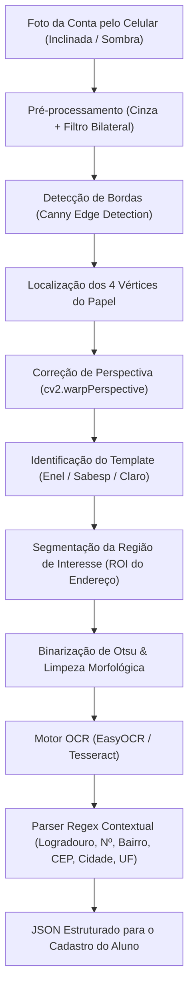

# Extração Automática de Endereços — Applied Computer Vision

## Global Solution 2026.2 — Engenharia de Software 4ESPR (FIAP)

**Professor:** Wilians Douglas Conde Souza
**Prazo de Entrega:** 19/11 às 23h55

---

## 👥 Equipe: **Bits N’ Bytes**

- **Jó Sales** — RM 552679
- **Miguel Garcez de Carvalho** — RM 553768
- **Vinicius Souza e Silva** — RM 552781
- **Edson Leonardo** — RM 553737
- **Eduardo Mazelli** — RM 553236

**MVP integrado:** Apoio Escolar Periférico · https://app-apoioescolar-mvp-6e7462.azurewebsites.net
**Repositório:** https://github.com/GiantMazelliWasHere/apoio-escolar-periferico (esta pasta: `visao/`)
**Entrega no portal:** o link do repositório e o PDF [`Relatorio_Tecnico_Visao_Computacional_BitsNBytes.pdf`](Relatorio_Tecnico_Visao_Computacional_BitsNBytes.pdf)
**ODS Vinculados:** **ODS 4** (Educação de Qualidade) e **ODS 10** (Redução das Desigualdades)

---

## 1. Conceito da Atividade & Papel no MVP

O **Apoio Escolar Periférico** conecta estudantes de escolas públicas da periferia a monitorias voluntárias. No cadastro, o estudante pode informar bairro e CEP.

Para o estudante não precisar digitar o endereço no celular, a equipe desenvolveu este componente de **Visão Computacional** que processa fotografias de comprovantes de residência de **três concessionárias diferentes**:

1. **ENEL** (Energia Elétrica)
2. **SABESP** (Saneamento Básico)
3. **CLARO** (Telecomunicações)

O pipeline extrai automaticamente os dados de endereço e CEP do titular, **distinguindo-os dos demais endereços corporativos da fatura**, e preenche o cadastro no MVP para o estudante conferir e corrigir. No MVP, o pipeline roda em [`mvp/app/visao.py`](../mvp/app/visao.py) e é chamado por `POST /api/v1/visao/endereco` (contrato em [docs/INTEGRACAO.md](../docs/INTEGRACAO.md)).

**Métricas medidas com EasyOCR real** (15 contas sintéticas e 15 fotos simuladas, contra o gabarito): [`resultados/metricas.md`](resultados/metricas.md).

---

## 2. Arquitetura do Pipeline de Visão Computacional



---

## 3. Heurísticas de Segregação de Endereço por Concessionária

O grande desafio técnico cobrado é **diferenciar o endereço do cliente dos endereços corporativos da fatura**:

- **ENEL:** O cabeçalho contém o endereço da sede da concessionária (*"Av. das Nações Unidas"*). O endereço do consumidor é isolado localizando o bloco inferior ao logotipo com o identificador `"DADOS DO CLIENTE"` ou `"ENDEREÇO DE ENTREGA"`.
- **SABESP:** O rodapé contém dados institucionais da Sabesp em fonte minúscula. A ROI do cliente é recortada na área delimitada pelo termo `"ENDEREÇO DO IMÓVEL"` ou `"LOCAL DA LIGAÇÃO"`.
- **CLARO:** A fatura utiliza padrão envelope/janela postal. A extração foca estritamente no bloco de correspondência (`NOME -> LOGRADOURO -> BAIRRO -> CEP`).

---

## 4. Como Executar

### 1. Iniciar o Hub Web Interativo no Navegador (Recomendado):

Execute o comando abaixo e abra seu navegador em `http://127.0.0.1:5000`:

```bash
python web_hub.py
# ou alternativamente:
py -3.11 web_hub.py
```

* **Funcionalidades do Hub:**
  * Modo Claro Institucional nativo por padrão (com alternador para Modo Escuro).
  * Exemplos das 3 concessionárias (Enel, Sabesp, Claro) carregáveis com 1 clique.
  * Upload arrastando PDF vetorial ou fotos do celular (PNG, JPG).
  * Visualização lado a lado do pipeline em linguagem clara e humana: 1. Documento Original, 2. Alinhamento de Margens e 3. Nitidez e Contraste.
  * Formulário de matrícula pré-preenchido e editável com validação de zoneamento socioeducativo.
  * **Conformidade LGPD:** Todo o processamento ocorre em memória volátil (RAM), sem retenção de arquivos em disco. Modal de política de privacidade formal no rodapé.

### 2. Instalar as dependências:

```bash
py -3.11 -m pip install -r requirements.txt
```

### 3. Gerar o dataset sintético de testes (LGPD):

```bash
py -3.11 generate_dataset.py
```

*Gera 15 faturas sintéticas (5 Enel, 5 Sabesp, 5 Claro) e o arquivo `ground_truth.json`.*

### 4. Executar os testes automatizados:

```bash
py -3.11 -m pytest test_cv.py -v       # geometria, empresa e regex desta pasta
```

Os testes do pipeline integrado (regras de extração, perspectiva e API, com OCR simulado) ficam em `mvp/tests/test_visao.py` e rodam no CI.

### 4b. Medir o acerto com OCR real (gera fotos simuladas e as métricas):

```bash
# na raiz do repositório, com o venv do MVP e mvp/requirements-visao.txt instalado
mvp/.venv/Scripts/python visao/avaliar_dataset.py
```

*Grava `dataset_sintetico/fotos_simuladas/` e `resultados/metricas.json` / `metricas.md`. O PDF é refeito com `python generate_pdf_report.py` (lê as métricas desse JSON).*

### 5. Processar via Linha de Comando (CLI):

```bash
# Processar uma fatura de exemplo (Enel, Sabesp ou Claro):
py -3.11 process_bill.py dataset_sintetico/enel_01.png
py -3.11 process_bill.py dataset_sintetico/sabesp_01.png
py -3.11 process_bill.py dataset_sintetico/claro_01.png

# Processar um documento PDF ou foto:
py -3.11 process_bill.py seu_comprovante.pdf
```

*O pipeline localiza os 4 vértices do papel, corrige a perspectiva geométrica (`warpPerspective`), aplica binarização de Otsu e extrai os dados estruturados em JSON.*
